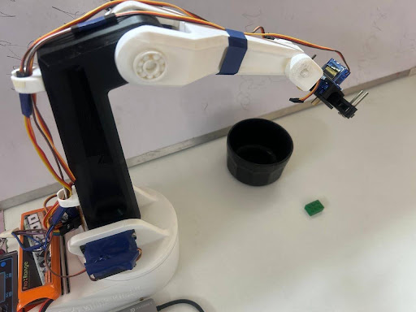
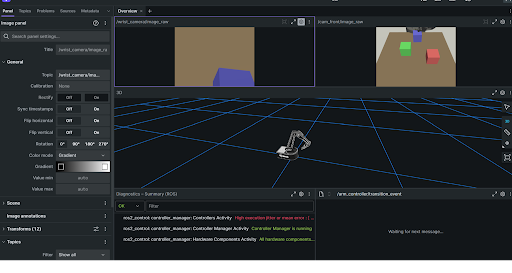

# NexusArm — 4-DOF Printed Arm: Sim - Hardware - Learning

 
A 4-DOF printed arm with one stable `MoveTo` API across Gazebo Harmonic sim, real hardware, and a learned ACT policy — deployed on **Arduino Uno Q (QRB2210)** via Docker `shreeshinator/nexusarm:unoq[...]